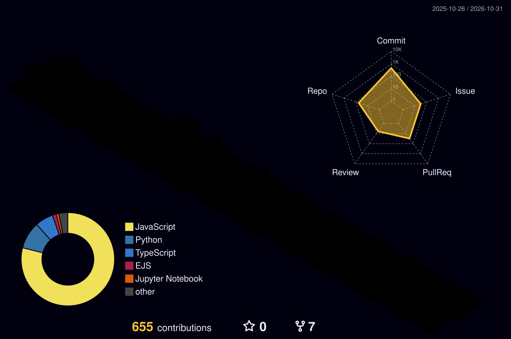

<a href="https://parthtandalwade.vercel.app">
  
</a>

<p align="center">
  <a href="https://parthtandalwade.vercel.app"></a>
  <a href="https://www.linkedin.com/in/parth-tandalwade-295882323/"></a>
  <a href="mailto:parth.k@adypu.edu.in"></a>
  
</p>

```ts
const parth = {
  role:        "Developer",
  basedIn:     "Pune, India",
  studying:    "B.Tech CSE (AI/ML) @ Newton School of Technology",
  previously:  ["Ionage", "Instilit", "PopularDigital.AI"],
  enjoys:      ["shipping fast", "interfaces that feel smooth", "a clean API"],
  offline:     ["swimming", "volleyball", "anime"],
  askMeAbout:  "RAG pipelines, React Native, or your next anime pick",
};
```

<h3 align="center">Things I've built</h3>

<table align="center">
  <tr>
    <td align="center" width="25%">
      <a href="https://github.com/KhanjarSingh/Knowra"><b>Knowra</b></a><br/>
      <sub>Chat with any codebase or PDF, with cited answers</sub><br/>
      <a href="https://knowra-jyg3.vercel.app/"><sub>live ↗</sub></a>
    </td>
    <td align="center" width="25%">
      <a href="https://github.com/KhanjarSingh/QuestLog"><b>QuestLog</b></a><br/>
      <sub>A to-do app that levels you up with XP and streaks</sub><br/>
      <a href="https://questlog.expo.app/"><sub>live ↗</sub></a>
    </td>
    <td align="center" width="25%">
      <a href="https://github.com/KhanjarSingh/AInalyst"><b>AInalyst</b></a><br/>
      <sub>Competitor research on autopilot, powered by Gemini</sub><br/>
      <a href="https://ainalyst.vercel.app/"><sub>live ↗</sub></a>
    </td>
    <td align="center" width="25%">
      <a href="https://github.com/KhanjarSingh/Codehive"><b>CodeHive</b></a><br/>
      <sub>A Q&amp;A platform where developers ask and answer</sub><br/>
      <a href="https://codehive-zfnt.vercel.app/"><sub>live ↗</sub></a>
    </td>
  </tr>
</table>

<p align="center">
  
</p>

<h3 align="center">Under the surface</h3>

<p align="center">
  <picture>
    <source media="(prefers-color-scheme: dark)" srcset="./profile-3d-contrib/profile-night-rainbow.svg" />
    <source media="(prefers-color-scheme: light)" srcset="./profile-3d-contrib/profile-gitblue.svg" />
    
  </picture>
</p>

<p align="center">
  <a href="https://leetcode.com/u/parth_0007/"></a>
  <a href="https://codeforces.com/profile/parth_0007"></a>
</p>

<p align="center">
  
</p>

<p align="center">
  <picture>
    <source media="(prefers-color-scheme: dark)" srcset="https://raw.githubusercontent.com/KhanjarSingh/KhanjarSingh/output/snake-dark.svg" />
    <source media="(prefers-color-scheme: light)" srcset="https://raw.githubusercontent.com/KhanjarSingh/KhanjarSingh/output/snake-light.svg" />
    
  </picture>
</p>

<p align="center"><sub>Google Big Code · Round 2 &nbsp;·&nbsp; Project Morpheus · 2nd of 500+ teams &nbsp;·&nbsp; Hacktoberfest 2024 &amp; 2025</sub></p>
